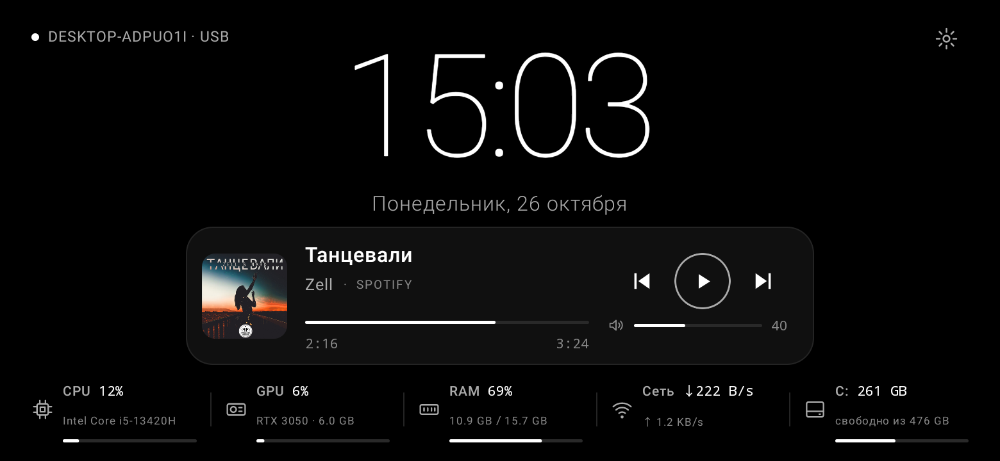
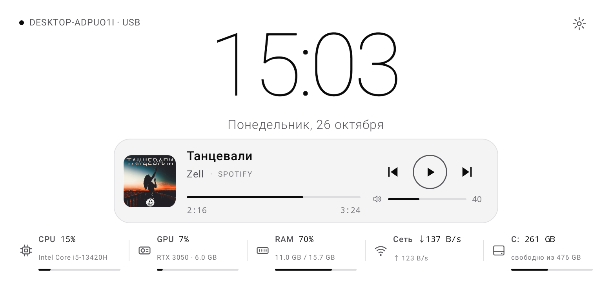
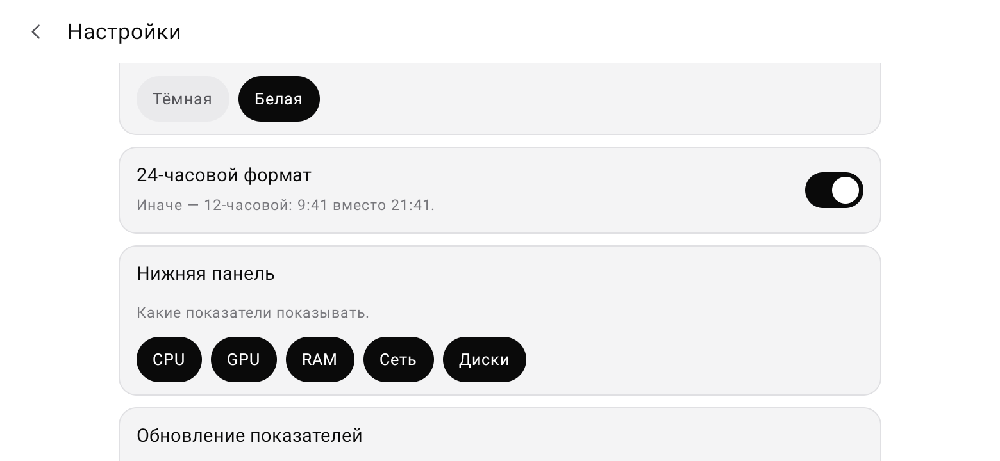
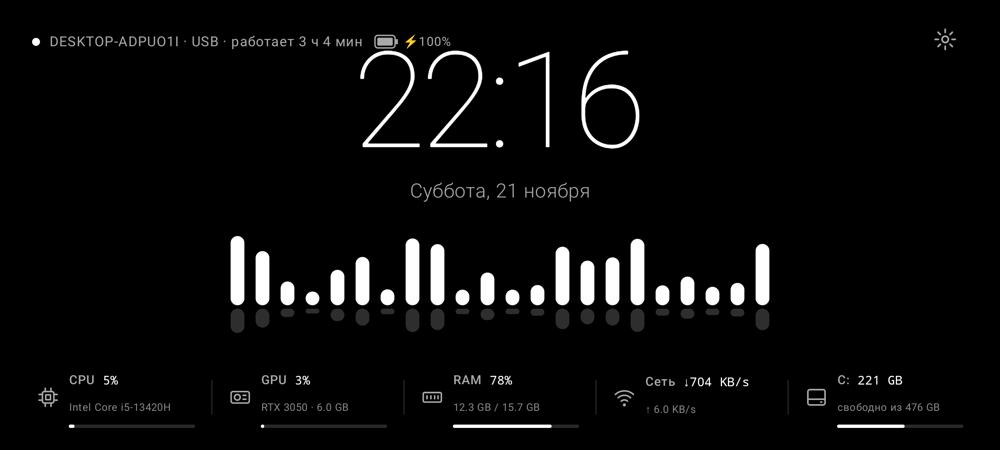

# PulseDeck Panel

**Старый Android-телефон как второй экран компьютера: часы, показатели ПК и музыка.**

**Android 8+ · Kotlin · Jetpack Compose · Material 3 · TLS · Wi-Fi и USB**

## Что это

PulseDeck Panel превращает телефон, стоящий рядом с монитором, в информационную панель для
компьютера с программой **PulseDeck** для Windows. Экран альбомный и рассчитан на то, чтобы
работать часами: тонкий шрифт, чёрный фон для AMOLED, сдвиг содержимого против выгорания
и ночное затемнение.

Все цифры — настоящие данные с ПК. Если значение неизвестно, показывается «—», а не выдуманное число.

## Возможности

| | |
|---|---|
| **Раскладки** | Panel, Часы, Музыка, Мониторинг — тап по часам переключает |
| **Часы и дата** | Цвет, 7 шрифтов телефона, толщина, размер S/M/L, секунды, 24/12 ч, «Сейчас на ПК» под датой |
| **Плитки** | CPU, GPU, RAM, сеть, диск (один или все по очереди), видеопамять, ядра, громкость ПК — выбор и порядок; по тапу подробности с графиком за 3 минуты |
| **Музыка** | Что играет на ПК (Spotify, Яндекс Музыка, браузеры, Медиаплеер — всё, что видит Windows), выбор источника, обложка, ползунок волной как в One UI, полоски «играет», громкость ПК, жесты: свайпы и двойной тап |
| **Оформление** | Тёмная и белая тема (и по времени суток), 7 цветов акцента, цвет из обложки, размытая обложка на фоне, 7 фонов на тему, шрифт интерфейса |
| **Анимации** | 30 анимаций, пока ничего не играет (волна KiroX, эквалайзер, галактика, дождь…), три размера |
| **Предупреждения** | Свои пороги для процессора, видеокарты, памяти, видеопамяти, диска, батареи ПК; подсветка плитки, уведомление, «нет связи» — и в фоне |
| **Связь** | Wi-Fi или USB-кабель; переключение на кабель, как только он подключён; автоматическое переподключение |
| **Фоновая работа** | Управление музыкой из уведомления; запуск после включения и разблокировки телефона |
| **Забота об экране** | Сдвиг содержимого против выгорания, ночное затемнение по расписанию, без связи — только часы |
| **Частота кадров** | Экономно 30 / Плавно 60 / Максимум (90–144 Гц): анимации и сам экран переключаются на эту частоту |
| **Слабые телефоны** | Облегчённый режим включается сам (мало памяти или ядер): анимации 30 кадров, без размытия и переходов. Ставится на Android 8 и новее |
| **Несколько ПК** | Список сохранённых компьютеров, переключение, «Забыть» |

Настройки и их значения совпадают с веб-панелью PulseDeck — браузерной версией этого экрана.
Выбор источника и «Сейчас на ПК» работают с PulseDeck 1.0.4 и новее.

### Белая тема

### Без музыки — анимация

## Как подключить

1. На ПК установите и запустите **PulseDeck** 1.0 или новее (для всех возможностей — 1.0.4).
2. Телефон и ПК в одной сети Wi-Fi — или телефон подключён кабелем с включённой «Отладкой по USB».
3. Откройте PulseDeck Panel: она сама найдёт ПК в сети.
4. На ПК откройте **«Телефон» → «Показать код»**. На телефоне сверьте отпечаток сертификата
   и введите 6 цифр.

После этого телефон подключается сам при каждом запуске.

### Через USB

Включите на телефоне «Параметры разработчика» (7 нажатий на «Номер сборки») и «Отладку по USB»,
разрешите отладку для этого ПК. PulseDeck на ПК сам пробрасывает порт через `adb reverse`, а панель
переходит на кабель, как только он доступен (значок «· USB»).

## Безопасность

- **Связь.** Только TLS с закреплённым сертификатом ПК. Если сертификат изменится, панель остановится и попросит подключиться заново.
- **Хранение ключа.** Ключ доступа хранится зашифрованным в Android Keystore.
- **Без пароля.** Сопряжение — только по одноразовому коду с экрана ПК; ПК можно отозвать на его экране «Телефон».
- **Права.** Панель отправляет на ПК только команды плеера и громкости и выбор источника музыки.
- **Нет данных — нет цифр.** Неизвестные значения не подменяются.

## Устройство

| Пакет | Что внутри |
|---|---|
| `data/remote` | `PanelConnection` (WebSocket `/api/v1/display`, USB, переподключение), `PinnedTls`, `Discovery`, `PairingClient`, `Protocol` |
| `data/local` | `PairingStore` (несколько ПК, Keystore), `AppSettings` (настройки экрана одним JSON) |
| `feature/*` | `dashboard` (раскладки), `monitoring` (плитки, история, предупреждения), `music` (плеер, волна, цвет обложки), `connection`, `settings`, `clock`, `pulse` (анимации) |
| `service` | Фоновая служба с уведомлением, уведомления-предупреждения, запуск после включения телефона |

Протокол: `docs/PANEL_PROTOCOL.md` в репозитории PulseDeck.

## Лицензия

© KirDev. Все права защищены — см. [LICENSE](LICENSE).
