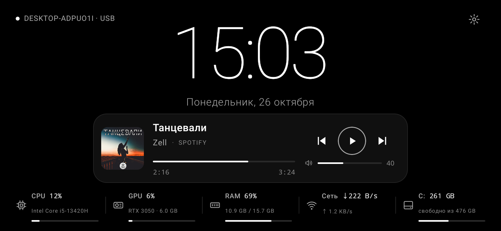
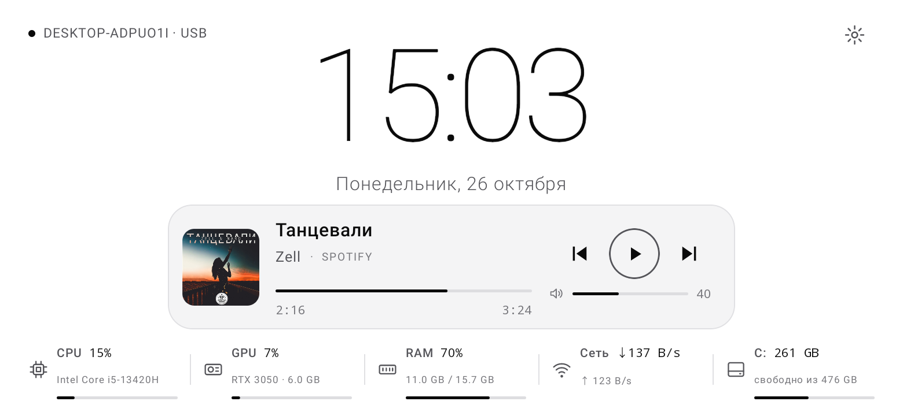
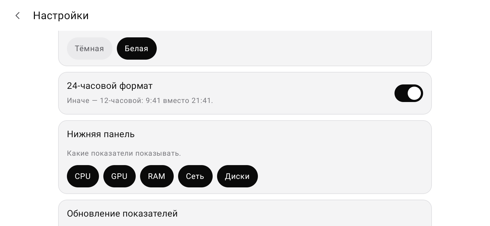
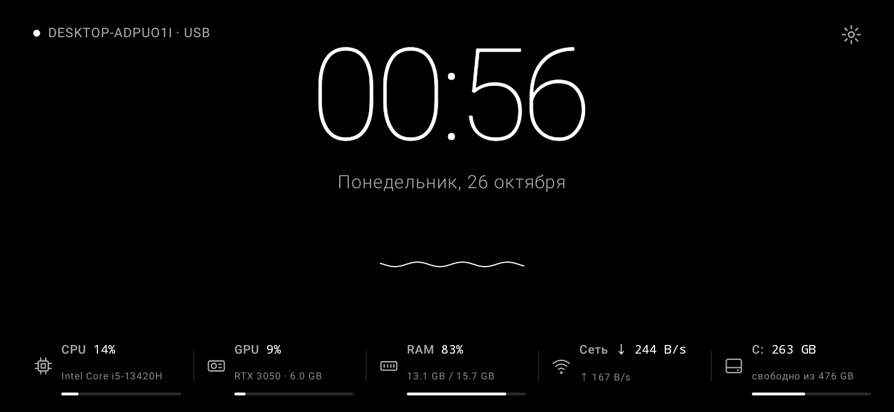

# PulseDeck Panel

**Старый Android-телефон как второй экран компьютера: часы, показатели ПК и музыка.**

**Android 11+ · Kotlin · Jetpack Compose · Material 3 · TLS · Wi-Fi и USB**

## Что это

PulseDeck Panel превращает телефон, стоящий рядом с монитором, в информационную панель для
компьютера с программой **PulseDeck** для Windows. Экран альбомный и рассчитан на то, чтобы
работать часами: тонкий шрифт, чёрный фон для AMOLED, сдвиг содержимого против выгорания
и ночное затемнение.

Все цифры — настоящие данные с ПК. Если значение неизвестно, показывается «—», а не выдуманное число.

## Возможности

| | |
|---|---|
| **Часы и дата** | Крупные часы, 24- или 12-часовой формат |
| **Показатели ПК** | CPU с названием процессора, GPU с названием и объёмом видеопамяти, RAM, скорость сети, диски (несколько — по очереди) |
| **Музыка** | Что играет на ПК (Spotify, Яндекс Музыка, браузеры, Медиаплеер — всё, что видит Windows), обложка, перемотка, кнопки, громкость ПК, название программы-источника |
| **Волна KiroX** | Анимированная волна, когда музыка не играет |
| **Связь** | Wi-Fi или USB-кабель; переключение на кабель, как только он подключён; автоматическое переподключение |
| **Фоновая работа** | Управление музыкой из уведомления; запуск после включения и разблокировки телефона |
| **Темы** | Тёмная (AMOLED) и белая, переключаются сразу |
| **Забота об экране** | Медленный сдвиг содержимого против выгорания, ночное затемнение по расписанию |
| **Несколько ПК** | Список сохранённых компьютеров, переключение, «Забыть» |

### Белая тема

### Без музыки — волна KiroX

## Как подключить

1. На ПК установите и запустите **PulseDeck** 1.0 или новее.
2. Телефон и ПК в одной сети Wi-Fi — или телефон подключён кабелем с включённой «Отладкой по USB».
3. Откройте PulseDeck Panel: она сама найдёт ПК в сети.
4. На ПК откройте **«Телефон» → «Показать код»**. На телефоне сверьте отпечаток сертификата
   и введите 6 цифр.

После этого телефон подключается сам при каждом запуске.

### Через USB

Включите на телефоне «Параметры разработчика» (7 нажатий на «Номер сборки») и «Отладку по USB»,
разрешите отладку для этого ПК. PulseDeck на ПК сам пробрасывает порт через `adb reverse`, а панель
переходит на кабель, как только он доступен (значок «· USB»).

## Безопасность

- **Связь.** Только TLS с закреплённым сертификатом ПК. Если сертификат изменится, панель остановится и попросит подключиться заново.
- **Хранение ключа.** Ключ доступа хранится зашифрованным в Android Keystore.
- **Без пароля.** Сопряжение — только по одноразовому коду с экрана ПК; ПК можно отозвать на его экране «Телефон».
- **Права.** Панель отправляет на ПК только команды плеера и громкости.
- **Нет данных — нет цифр.** Неизвестные значения не подменяются.

## Устройство

| Пакет | Что внутри |
|---|---|
| `data/remote` | `PanelConnection` (WebSocket `/api/v1/display`, USB, переподключение), `PinnedTls`, `Discovery`, `PairingClient`, `Protocol` |
| `data/local` | `PairingStore` (несколько ПК, Keystore), `AppSettings` |
| `feature/*` | `dashboard`, `monitoring`, `music`, `connection`, `settings`, `clock`, `pulse` (волна) |
| `service` | Фоновая служба с уведомлением, запуск после включения телефона |

Протокол: `docs/PANEL_PROTOCOL.md` в репозитории PulseDeck.

## Лицензия

© KirDev. Все права защищены — см. [LICENSE](LICENSE).
